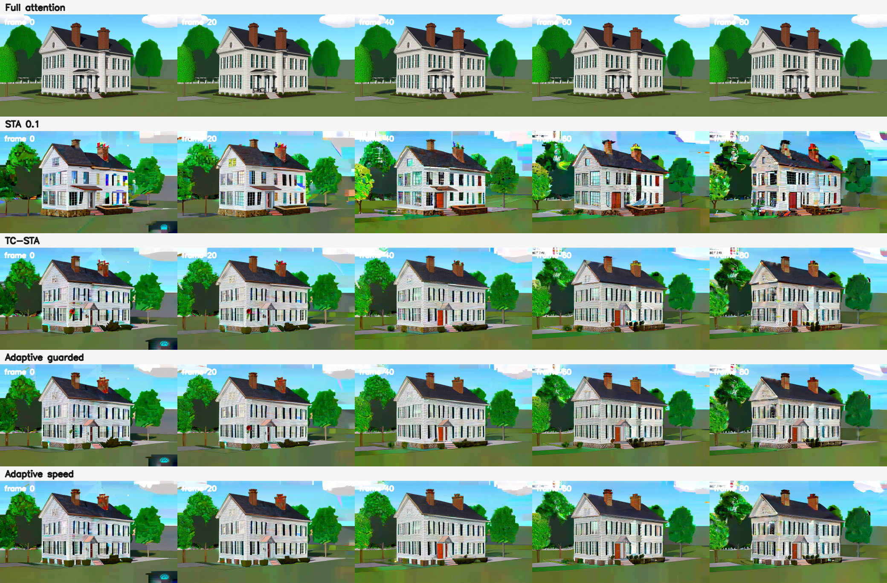

# SRTP-STA: TC-STA 与 Adaptive TC-STA 实验记录

本仓库保存 Wan2.1-T2V-1.3B 上的 STA 基线、TC-STA 和 Adaptive TC-STA 推理代码、离线策略、关键实验指标，以及重建环境的步骤。云端模型权重和完整生成视频不在仓库内；下载权重后可重新运行。历史计时来自 A800，换成 RTX PRO 6000 或其他 GPU 时请重新测量。

**先读 [REPRODUCE.md](REPRODUCE.md)**：从安装、下载模型，到运行 Full / STA / TC-STA / Adaptive，再到质量分析和策略重建，都有完整命令。

## 方法与已有结果

STA 先用 16 条 prompt 的全注意力输出离线标定 `step × layer × head` 的基础模式。TC-STA 对小窗口 head 在线选择时间对应、纵向或横向路线，对中大窗口 head 加入有门控的时间锚点。Adaptive 按路线分数差决定使用 1、2 或 3 条路线，并离线将 200 个低误差贡献的 full-head 位置改为 `(5,3,5)`。算法与限制详见 [TC-STA 报告](correspondence_sta_experiment/final_report_zh.md)和 [Adaptive 报告](adaptive_multiroute_experiment/final_report_zh.md)。

在一条 Victorian prompt 的配对实验中，TC-STA、Adaptive debug、Adaptive production 相对 Full 的 SSIM 分别为 `0.58737`、`0.59321`、`0.59378`；去噪时间分别为 `172.04`、`172.20`、`161.59` 秒。production 的性能收益还包含实现优化，不能全部归因于路由算法。三条独立 prompt 的 **STA production vs Adaptive production** 平均 SSIM 为 `0.55237` vs `0.58970`，Adaptive 墙钟慢 `2.44%`、去噪慢 `6.13%`；运动人物场景仍有 tile 伪影。详细数据见 [多 prompt 报告](adaptive_multiroute_experiment/multi_prompt_report_zh.md)。

## 文件导航

| 路径 | 用途 |
|---|---|
| `correspondence_sta_experiment/code/correspondence_hybrid_flex.py` | TC-STA / Adaptive 共用的注意力和路由实现 |
| `correspondence_sta_experiment/code/correspondence_bridge.py` | 接入 Wan self-attention，跟踪去噪步和层 |
| `correspondence_sta_experiment/code/run_correspondence_wan.py` | 原 Wan `generate.py` 的命令行包装器 |
| `saswa.py`, `saswa_flex.py`, `saswa_grouped.py`, `wan_hybrid_flex.py`, `wan13b.py` | tile 几何、FlexAttention 和基础配置 |
| `wan_sta_reference.py`, `wan_sta_calibration.py` | STA 策略加载和离线标定 |
| `sta_calibration_50/strategies/sta_strategy_mse_0p1.json` | TC-STA 的原始 STA 0.1 策略 |
| `adaptive_multiroute_experiment/strategy_energy_safe.json` | 推荐 Adaptive 策略，200 个 full-head 位置已离线改写 |
| `scripts/run_reproduction.sh` | 可移植的四种模式运行入口 |
| `adaptive_multiroute_experiment/benchmark_victorian/analysis_final/` | 单 prompt 指标和对比图 |
| `adaptive_multiroute_experiment/benchmark_multi_prompt/analysis_sta/` | 三条独立 prompt 的配对指标和对比图 |
| `adaptive_multiroute_experiment/profiling/` | 真实 QKV 热点报告和结构化计时 |

本仓库是研究快照，原 Wan 仓库与模型分别属于原作者；请遵守对应许可证与使用条款。

